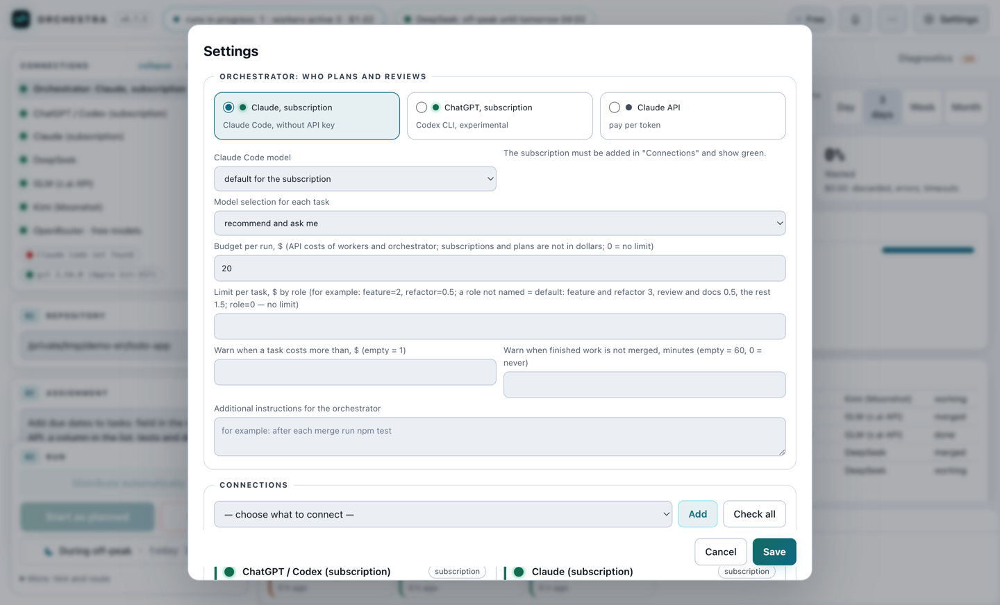
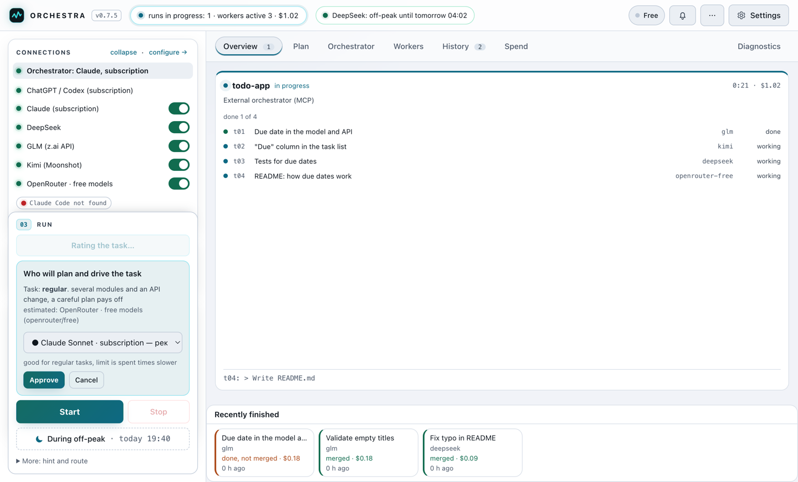
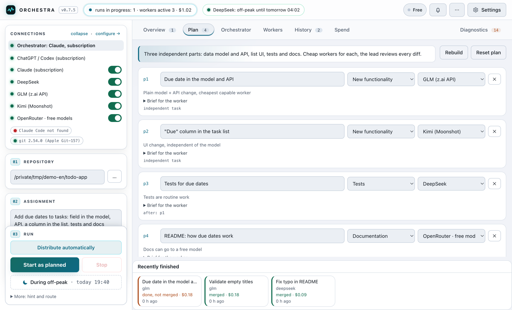
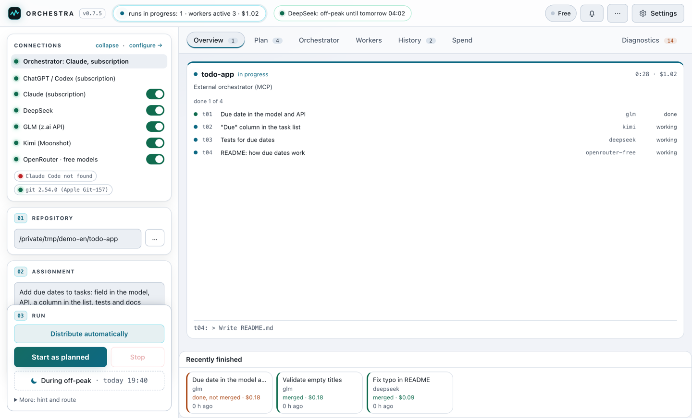
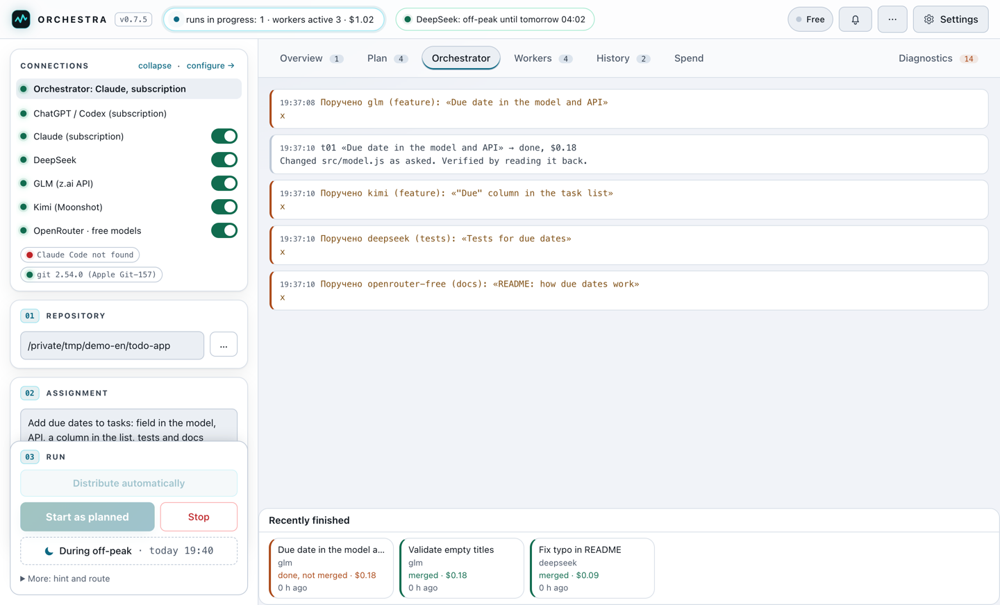
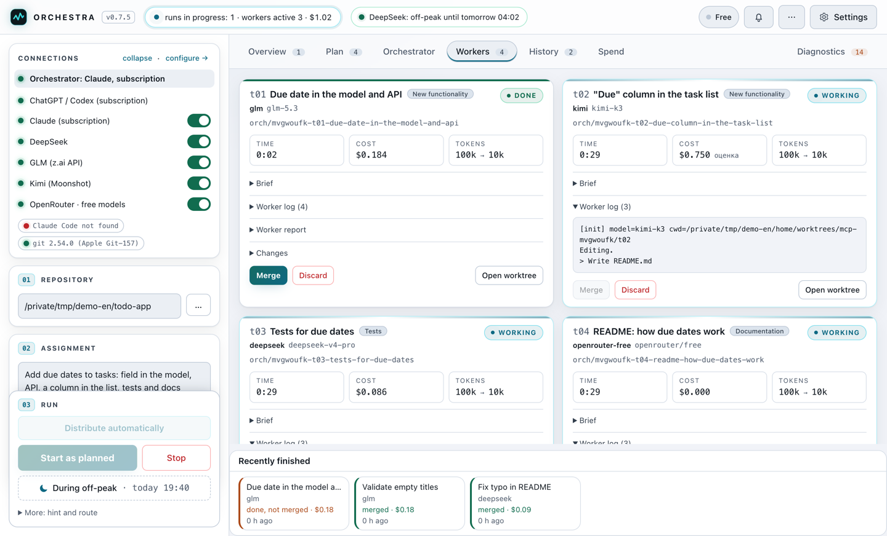
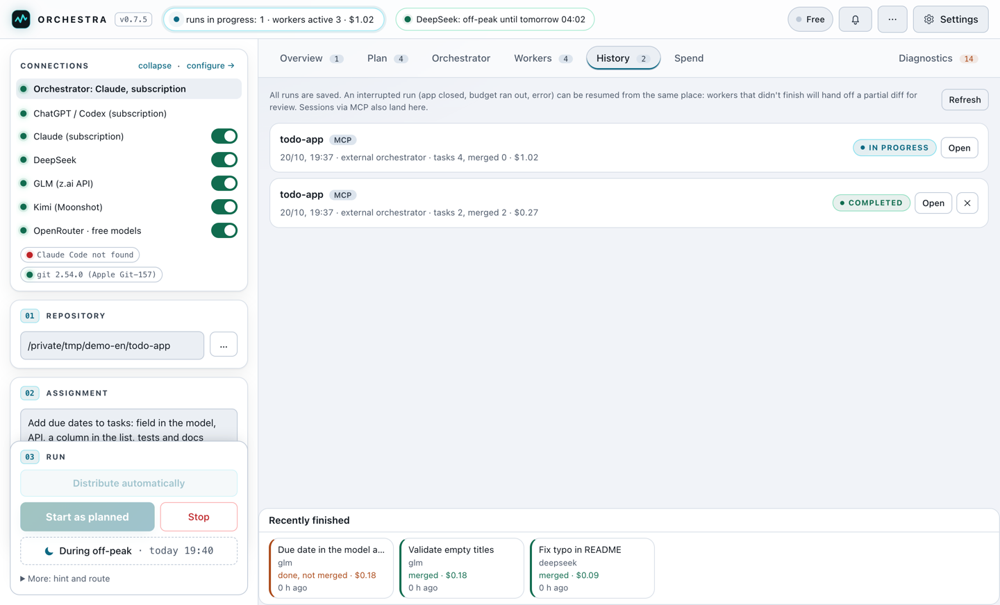
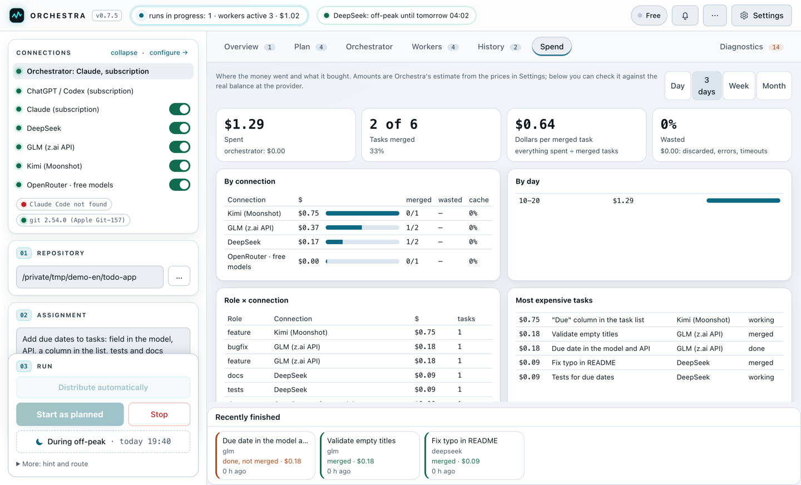

# How to use it: a tour of the panel

**English** · [Русский](TOUR.md)

A short tour: what each screen does and what to press, in order. Installation, keys and fine tuning are in [SETUP.en.md](SETUP.en.md).

The screenshots use demo data: a `todo-app` repository and the task «add due dates to tasks». The lead (Claude on a subscription) split it into four parts and handed them to cheap workers.

## 0. Start

```bash
git clone https://github.com/VProkhorov7/OrchestraPub.git
cd Orchestra
npm install
npm start          # desktop app
# or
npm run serve      # service: web panel + MCP; the address with its login token is printed to the console
```

You need Node.js 20+, git and [Claude Code](https://docs.claude.com/en/docs/claude-code), signed in (`claude`, then `/login`). The interface language is switched with the RU/EN button in the «⋯» menu.

## 1. Connections

**Settings → Connections**: pick what to connect from the list, press «Add», enter the key, press «Check». Two connections are enough to start:

- **the orchestrator**: Claude on a subscription (Pro or Max), no key needed, it uses your Claude Code sign-in;
- **at least one worker**: DeepSeek, GLM, Kimi or OpenRouter (OpenRouter has free models).

The same dialog sets the budget per run, caps per task, each worker's roles and prices. In the panel on the left every connection has a light: 🟢 working, 🟡 out of money or over its limit, 🔴 not connected. The switch turns a connection off for a while.



## 2. The assignment and who plans it

On the left, set the **repository** (a git folder with no uncommitted changes) and describe the **assignment** in plain words. Press **«Distribute automatically»**.

A cheap model rates the complexity and recommends who should plan: Opus for hard tasks, Sonnet for regular ones, or an API. Press «Approve» or choose another model.



## 3. The plan

The **Plan** tab shows the task split into parts. Each part has a title, a role (new functionality, bugfix, tests, docs…), a worker and a brief. You can edit any of them, delete a part or rebuild the plan. Then press **«Start as planned»**.

Not in a hurry? **«During off-peak»** schedules the run for DeepSeek's cheap hours.



## 4. Overview

The home tab: one card per running run, with its status, workers, spend and the last line of work. You can follow several projects at once, and watching costs nothing. «Recently finished» is at the bottom. Click a card to open the run.



## 5. Orchestrator and workers

**Orchestrator** shows what the lead is doing: what it handed to whom, what came back, what it merged.



**Workers**: one card per worker, with time, cost, tokens, the brief, a live log, the report and the changes (diff). Each worker runs in its own git worktree on its own branch, so your main branch stays untouched until a task is merged. **Merge** and **Discard** are also available by hand.



## 6. History and spend

**History** keeps every run. An interrupted run can be resumed where it stopped, and the branches of an old run can be merged or discarded later.



**Spend** shows where the money went: by connection, role and day, the most expensive tasks, the cost of one merged task and how much was wasted.



## 7. Driving it from your own agent

Orchestra is also an MCP server. Claude Code, Codex, Cursor or an agent in Orca can hand tasks to the workers themselves, or give a whole task to the autopilot:

```bash
claude mcp add --transport http orchestra "http://localhost:7777/mcp?repo=$(pwd)" \
  --header "Authorization: Bearer <token printed by npm run serve>"
```

Then tell the agent: *«Hand this task to Orchestra's workers, review their diffs and merge»*. The session shows up in Overview and History marked MCP.

## Further reading

- [SETUP.en.md](SETUP.en.md): installation, home server, MCP, Orca, budgets, troubleshooting.
- [MEMORY.en.md](MEMORY.en.md): project memory (facts, decisions, journal, wiki).
- [TECHNICAL.md](TECHNICAL.md): how it works inside.

**Security.** Workers run on your machine without permission prompts: in separate worktrees, but with shell access. Do not expose the service port to the internet; use localhost or Tailscale.
