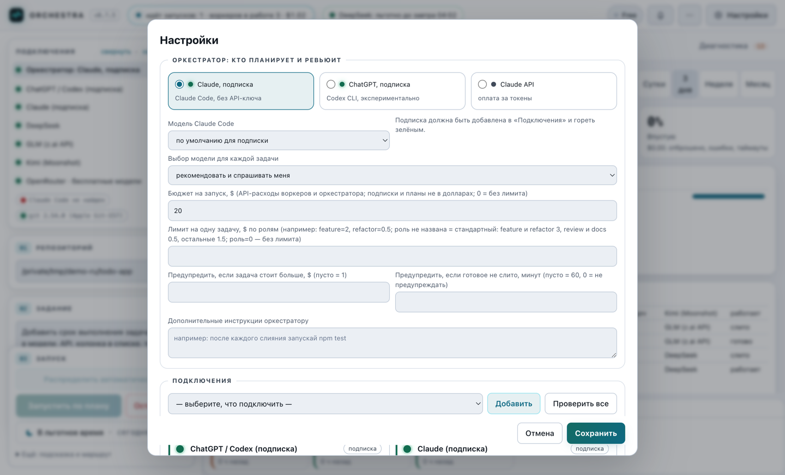
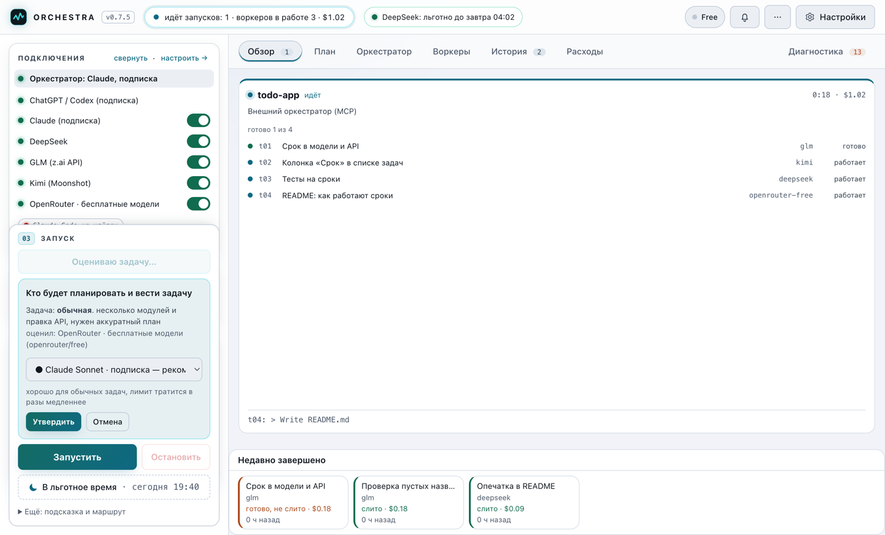
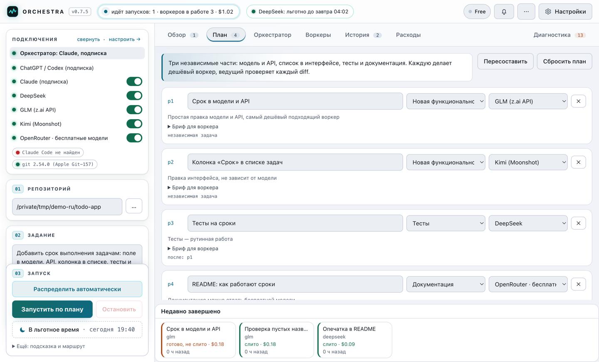
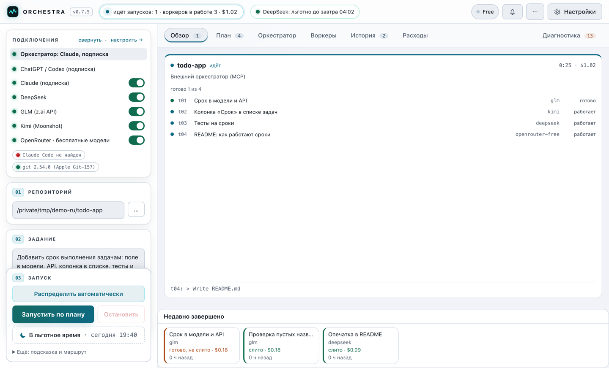
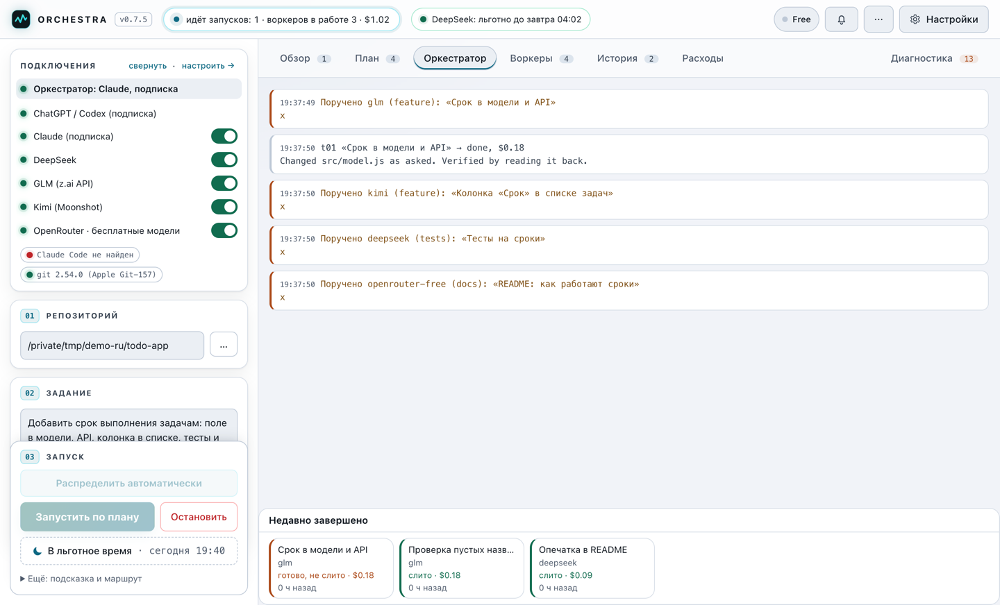
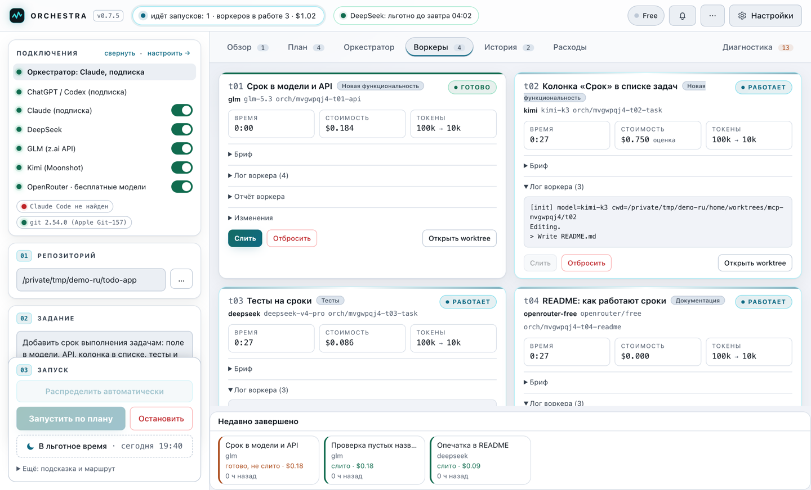
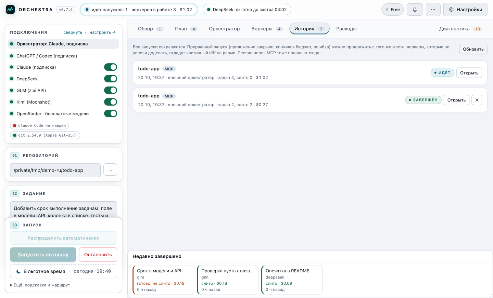
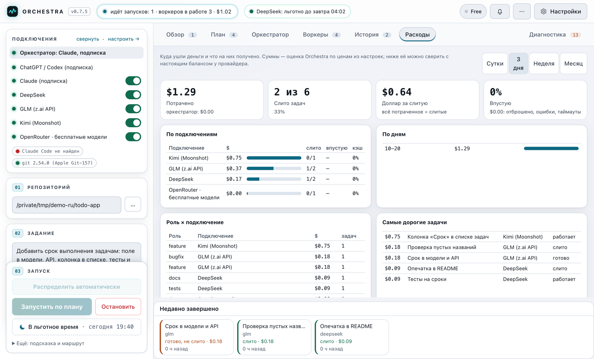

# Как пользоваться: обзор панели

[English](TOUR.en.md) · **Русский**

Короткий обзор: что на каком экране и в каком порядке нажимать. Установка, ключи и тонкая настройка описаны в [SETUP.md](SETUP.md).

Скриншоты сняты на демо-данных: репозиторий `todo-app` и задача «добавить задачам срок выполнения». Ведущий (Claude по подписке) разбил её на четыре части и раздал дешёвым воркерам.

## 0. Запуск

```bash
git clone https://github.com/VProkhorov7/OrchestraPub.git
cd Orchestra
npm install
npm start          # настольное приложение
# или
npm run serve      # служба: веб-панель + MCP; адрес со входным токеном печатается в консоль
```

Нужны Node.js 20+, git и [Claude Code](https://docs.claude.com/en/docs/claude-code), в котором выполнен вход (`claude`, затем `/login`).

## 1. Подключения

**Настройки → Подключения**: выберите в списке, что подключить, нажмите «Добавить», введите ключ и нажмите «Проверить». Для начала хватит двух подключений:

- **оркестратор**: Claude по подписке (Pro или Max), ключ не нужен, берётся вход Claude Code;
- **хотя бы один воркер**: DeepSeek, GLM, Kimi или OpenRouter (у OpenRouter есть бесплатные модели).

Здесь же задаются бюджет на запуск, лимиты на задачу, роли каждого воркера и цены. Слева в панели у каждого подключения горит свой цвет: 🟢 работает, 🟡 нет денег или исчерпан лимит, 🔴 не подключено. Переключателем подключение можно временно выключить.



## 2. Задание и выбор планировщика

Слева укажите **репозиторий** (папку с git, без незакоммиченных изменений) и опишите **задание** обычными словами. Нажмите **«Распределить автоматически»**.

Дешёвая модель оценивает сложность и советует, кто будет планировать: Opus для сложных задач, Sonnet для обычных, или API. Нажмите «Утвердить» или выберите другую модель.



## 3. План

На вкладке **«План»** задача разбита на части. У каждой части есть название, роль (новая функциональность, исправление, тесты, документация…), исполнитель и бриф. Всё это можно поправить руками, удалить лишнее или перестроить план. Затем нажмите **«Запустить по плану»**.

Если без спешки: кнопка **«В льготное время»** отложит запуск до дешёвых часов DeepSeek.



## 4. Обзор

Главная вкладка. На ней по карточке на каждый идущий запуск: статус, исполнители, расход, последняя строка работы. Можно вести несколько проектов сразу, а смотреть на них ничего не стоит. Внизу лента «Недавно завершено». Щелчок по карточке открывает запуск.



## 5. Оркестратор и воркеры

**«Оркестратор»** показывает, что делает ведущий: кому что поручил, что получил и что слил.



**«Воркеры»**: карточка на каждого исполнителя. На ней время, стоимость, токены, бриф, живой лог, отчёт и изменения (diff). Каждый воркер работает в своём git worktree и в своей ветке, поэтому ваша основная ветка не меняется, пока задачу не слили. Кнопки **«Слить»** и **«Отбросить»** доступны и вручную.



## 6. История и расходы

**«История»** хранит все запуски. Прерванный запуск можно продолжить с того же места, а ветки старого запуска слить или отбросить позже.



**«Расходы»** показывают, куда ушли деньги: по подключениям, ролям и дням, самые дорогие задачи, цену одной слитой задачи и сколько ушло впустую.



## 7. Если хочется вести из своего агента

Orchestra работает как MCP-сервер. Claude Code, Codex, Cursor или агент в Orca могут сами раздавать задачи воркерам или отдать всю задачу автопилоту:

```bash
claude mcp add --transport http orchestra "http://localhost:7777/mcp?repo=$(pwd)" \
  --header "Authorization: Bearer <токен из консоли npm run serve>"
```

После этого скажите агенту: *«Раздай эту задачу воркерам Orchestra, проверь их diff и слей»*. Такой запуск появится в «Обзоре» и в «Истории» с пометкой MCP.

## Что ещё почитать

- [SETUP.md](SETUP.md): установка, домашний сервер, MCP, Orca, бюджеты, что делать, если что-то не так.
- [MEMORY.md](MEMORY.md): память проекта (факты, решения, журнал, wiki).
- [TECHNICAL.md](TECHNICAL.md): как всё устроено внутри.

**Безопасность.** Воркеры работают на вашей машине без запросов разрешений: в отдельных worktree, но с доступом к shell. Не открывайте порт службы в интернет, используйте localhost или Tailscale.
